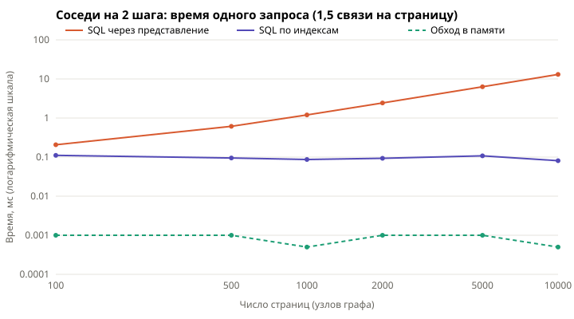
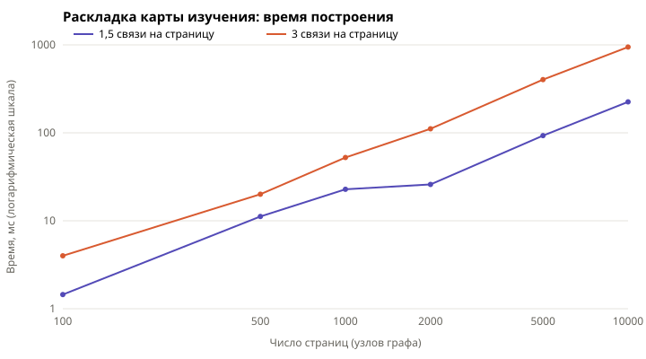

# Эксперименты: производительность при росте базы

Оценивается, как выбранный способ хранения и алгоритмы ведут себя при росте базы.
Запуск: `npm run bench` (затем `node scripts/make-charts.mjs` — графики). Сырые данные — [experiments-results.json](experiments-results.json).

## Условия

- Тестовые графы от 100 до 10 000 узлов создаёт генератор [`bench/generator.ts`](../bench/generator.ts) с фиксированным зерном
  (результат воспроизводим); две плотности — 1,5 и 3 связи «требует знания» на страницу; циклов нет.
- Каждое измерение повторяется 10 раз после прогрева, берётся медиана; обход запускается из 10 случайных узлов.
- Среда записывается в файл результатов (версия Node.js, ОС, процессор).
- **Ограничение:** замеры идут в Node.js на той же сборке SQLite WASM и том же коде, что и в браузере, но с базой в памяти.
  Чтение в браузере (OPFS) после первого обращения тоже идёт из кеша страниц SQLite, поэтому порядок величин тот же;
  замер стоит повторить в целевых браузерах (Chrome, Firefox, Safari) и вписать их версии.

## 1. Обход графа: рекурсивный SQL-запрос против обхода в памяти

Измеряется поиск соседей на 1–3 шага. Сравниваются три способа:
рекурсивный запрос (recursive CTE) через представление `graph_edges`, тот же запрос напрямую по таблицам с индексами
и обход в ширину по спискам смежности в памяти. Оба SQL-варианта и обход в памяти в каждом прогоне дают одинаковое множество узлов (это проверяется).

Выводы:

1. **Запрос через представление растёт линейно с размером базы** — 0,2 мс на 100 узлах и 13 мс на 10 000 даже для одного шага:
   сквозь `UNION` SQLite не использует индексы и на каждом шаге рекурсии просматривает все связи.
2. **Запрос по индексам не зависит от размера базы** — 0,06–0,2 мс при 1,5 связи на страницу и до 1,8 мс при 619 найденных соседях:
   время определяется числом найденных узлов, а не числом страниц. После эксперимента приложение переведено на этот вариант
   (`neighborIds` в [`src/data/services/graph.ts`](../src/data/services/graph.ts)).
3. **Обход в памяти быстрее на 1–2 порядка** (0,002–0,04 мс), но требует прочитать все связи и построить списки смежности:
   40–80 мс на 10 000 узлов. Он выгоден, когда граф уже загружен (карта, обзор, цепочка изучения — приложение хранит рёбра
   в кеше до следующего изменения), а SQL-запрос — для точечного вопроса «соседи одной страницы» без загрузки всего графа.
4. Требование «поиск и запросы — до 1 с» выполняется с запасом на всех размерах.

## 2. Визуализация: раскладка карты изучения

Измеряется время послойной раскладки (алгоритм Сугиямы, [`src/core/layout.ts`](../src/core/layout.ts)) и число пересечений
соединителей до и после уменьшения пересечений (проходы по барицентрам).

Выводы:

1. **Время раскладки растёт почти линейно**: 1 000 узлов — 23 мс (52 мс при плотности 3), 10 000 — 0,23 с (0,95 с).
   Требование «граф до 1000 узлов отображается без заметных задержек» выполняется.
2. **Проходы по барицентрам убирают 60–70 % пересечений** относительно исходного порядка по названию.
3. Случайный граф заведомо хуже реальной базы: в нём нет тематических веток, поэтому абсолютное число пересечений велико.
   На плотных графах от 2 000 узлов карта целиком нечитаема при любой раскладке — поэтому в приложении есть фильтры
   «ветка страницы» и «отмеченные и что нужно до них», а маленький граф показывает соседей по глубине.
4. **Не измерено:** время отрисовки SVG в браузере. Его нужно замерить в целевых браузерах (Performance API) отдельно.

## Таблицы

Условия: Node.js v24.21.0, darwin 27.0.0 (arm64), Apple M5; SQLite WASM (@sqlite.org/sqlite-wasm), база в памяти; 10 повторов, медиана; 10 случайных стартовых узлов.

### Плотность 1.5 связи на страницу

**Обход графа**

| Узлов | Связей | Соседей, 1 шаг | SQL по индексам, мс | SQL через представление, мс | Память, мс | Соседей, 2 шага | SQL по индексам, мс | SQL через представление, мс | Память, мс | Соседей, 3 шага | SQL по индексам, мс | SQL через представление, мс | Память, мс | Путь BFS, мс | Чтение связей, мс | Списки смежности, мс |
| ---: | ---: | ---: | ---: | ---: | ---: | ---: | ---: | ---: | ---: | ---: | ---: | ---: | ---: | ---: | ---: | ---: |
| 100 | 150 | 4 | 0.097 | 0.2 | 0 | 13.5 | 0.111 | 0.207 | 0.001 | 33.5 | 0.162 | 0.256 | 0.003 | 0.006 | 0.535 | 0.015 |
| 500 | 750 | 3.5 | 0.065 | 0.599 | 0 | 16 | 0.095 | 0.613 | 0.001 | 73.5 | 0.221 | 0.733 | 0.003 | 0.026 | 1.976 | 0.038 |
| 1000 | 1500 | 3.5 | 0.063 | 1.191 | 0 | 14 | 0.087 | 1.201 | 0 | 51 | 0.187 | 1.311 | 0.003 | 0.062 | 3.921 | 0.075 |
| 2000 | 3000 | 3 | 0.062 | 2.415 | 0 | 15.5 | 0.093 | 2.436 | 0.001 | 73.5 | 0.248 | 2.581 | 0.004 | 0.088 | 8.081 | 0.17 |
| 5000 | 7500 | 4.5 | 0.062 | 6.251 | 0 | 20 | 0.108 | 6.318 | 0.001 | 78 | 0.356 | 6.533 | 0.005 | 0.278 | 20.064 | 0.36 |
| 10000 | 15000 | 4 | 0.061 | 13.018 | 0 | 11 | 0.081 | 13.052 | 0 | 40.5 | 0.193 | 13.166 | 0.002 | 0.839 | 40.174 | 0.873 |

**Раскладка карты**

| Узлов | Связей | Слоёв | Раскладка, мс | Пересечений до | Пересечений после | Снижение, % |
| ---: | ---: | ---: | ---: | ---: | ---: | ---: |
| 100 | 150 | 11 | 1.451 | 1793 | 518 | 71 |
| 500 | 750 | 15 | 11.193 | 40522 | 14363 | 65 |
| 1000 | 1500 | 12 | 22.8 | 192483 | 66800 | 65 |
| 2000 | 3000 | 17 | 25.916 | 701310 | 279948 | 60 |
| 5000 | 7500 | 21 | 93 | 4270256 | 1601102 | 63 |
| 10000 | 15000 | 21 | 225.034 | 16456134 | 6305574 | 62 |

### Плотность 3 связи на страницу

**Обход графа**

| Узлов | Связей | Соседей, 1 шаг | SQL по индексам, мс | SQL через представление, мс | Память, мс | Соседей, 2 шага | SQL по индексам, мс | SQL через представление, мс | Память, мс | Соседей, 3 шага | SQL по индексам, мс | SQL через представление, мс | Память, мс | Путь BFS, мс | Чтение связей, мс | Списки смежности, мс |
| ---: | ---: | ---: | ---: | ---: | ---: | ---: | ---: | ---: | ---: | ---: | ---: | ---: | ---: | ---: | ---: | ---: |
| 100 | 300 | 5.5 | 0.066 | 0.263 | 0 | 41 | 0.151 | 0.35 | 0.002 | 95 | 0.336 | 0.488 | 0.006 | 0.005 | 0.748 | 0.007 |
| 500 | 1500 | 6.5 | 0.069 | 1.217 | 0 | 58 | 0.167 | 1.293 | 0.002 | 293.5 | 0.7 | 1.757 | 0.012 | 0.032 | 3.88 | 0.047 |
| 1000 | 3000 | 4 | 0.066 | 2.453 | 0 | 30 | 0.161 | 2.527 | 0.002 | 225.5 | 0.771 | 3.078 | 0.015 | 0.096 | 7.994 | 0.106 |
| 2000 | 6000 | 6.5 | 0.064 | 5.02 | 0 | 54 | 0.154 | 5.112 | 0.002 | 473.5 | 0.944 | 5.849 | 0.016 | 0.194 | 16.234 | 0.242 |
| 5000 | 15000 | 6 | 0.07 | 13.353 | 0 | 44.5 | 0.239 | 13.606 | 0.003 | 476.5 | 1.702 | 14.936 | 0.038 | 0.444 | 39.903 | 0.659 |
| 10000 | 30000 | 7 | 0.066 | 27.287 | 0 | 62 | 0.201 | 27.45 | 0.003 | 619 | 1.781 | 28.82 | 0.038 | 1.083 | 81.626 | 1.437 |

**Раскладка карты**

| Узлов | Связей | Слоёв | Раскладка, мс | Пересечений до | Пересечений после | Снижение, % |
| ---: | ---: | ---: | ---: | ---: | ---: | ---: |
| 100 | 300 | 13 | 4.003 | 11708 | 4088 | 65 |
| 500 | 1500 | 23 | 20.067 | 263928 | 103556 | 61 |
| 1000 | 3000 | 26 | 52.423 | 1129943 | 424437 | 62 |
| 2000 | 6000 | 30 | 111.256 | 4428564 | 1745147 | 61 |
| 5000 | 15000 | 35 | 403.134 | 27220403 | 10882452 | 60 |
| 10000 | 30000 | 36 | 945.695 | 106637518 | 42689182 | 60 |
